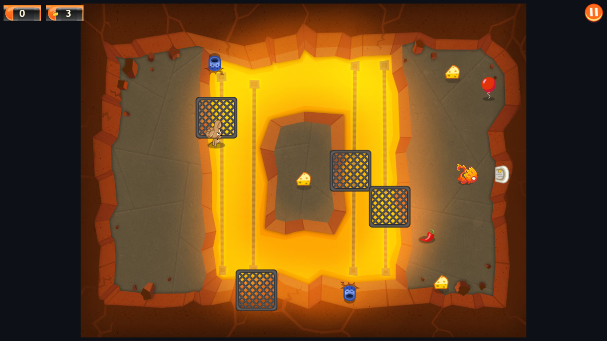

# Spy Mouse Web

> 一个使用 **Canvas 2D + 原生 ES Modules** 实现的《Spy Mouse / 间谍鼠》网页重制/技术研究项目。
>
> **本项目是非官方、非商业的粉丝技术研究项目，与 Electronic Arts、Firemint、PopCap、Disney、MuMu 模拟器或其他权利方没有任何隶属、授权、赞助或认可关系。**
>
> 仓库默认 **Private**。请先阅读文末的[完整免责声明](#完整免责声明--disclaimer)。如果你不是权利方，或不确定所在司法辖区的法律要求，请不要公开分发本仓库或其中的游戏资源。



---

## 目录

- [项目简介](#项目简介)
- [当前内容](#当前内容)
- [快速开始](#快速开始)
- [操作方式](#操作方式)
- [目录结构](#目录结构)
- [测试与验证](#测试与验证)
- [资源与重建流程](#资源与重建流程)
- [已知限制](#已知限制)
- [隐私与安全](#隐私与安全)
- [贡献](#贡献)
- [许可证](#许可证)
- [完整免责声明 / Disclaimer](#完整免责声明--disclaimer)
- [权利方移除请求](#权利方移除请求)

---

## 项目简介

本项目把《Spy Mouse》的核心玩法用网页技术重新实现，包括：

- 鼠标/触摸画线引导主角移动；
- 奶酪收集、猫的巡逻/发现/追逐/扑击、藏身点；
- 门、桥、闸门、大炮、电视、定时开关、电梯/地板、移动平台、Boss 机制等；
- 关卡地图、选关界面、独立楼房模块、结算/星级；
- 一个关卡编辑器与 Sprite Lab 辅助页面；
- 基于原生 APK 的静态逆向分析（REA）与 MuMu 模拟器对照资料。

代码不包含原版游戏的源代码。游戏资源预期仅与用户本机合法持有的游戏副本配合使用，经过离线解包/转码后用于本项目的可运行演示；**维护者不保证任何副本、提取物或再分发行为的合法性**。原始 APK、原始解包目录和逆向中间产物不会提交到仓库（见 `.gitignore`）。

### 技术栈

- 纯浏览器：HTML + CSS + Canvas 2D；
- 原生 ES Modules，无前端框架、无构建器；
- Node.js 仅用于本地静态服务器、资源导入脚本和测试；
- Playwright（仅测试）用于浏览器冒烟检查。

### 兼容性

- 推荐 Node.js **20+**；本项目开发/验证使用 Node.js 24；
- 推荐最新版 Chrome / Edge / Firefox；
- 桌面鼠标、触摸屏均可操作；
- 没有后端、没有账号系统、没有联网依赖。

---

## 当前内容

当前资源集包含：

- **121 个地图记录 / 182 个楼层**（含普通关、附加层、Boss 关）；
- 选关界面当前展示 **world 1–6** 的独立楼房模块；
- 最后一章的移动平台、电视、门/桥/电梯等机制与对应测试；
- 关卡编辑器 `editor.html`；
- Sprite Lab `spritelab.html`；
- 原生 MuMu 对照截图（见 `docs/`）。

> 说明：仓库中的菜单/存档解锁范围受当前资源与本地存档影响；某些章节（尤其 world 7/8）在现有 APK/存档中不可直接进入，相关验证以 REA + 模拟为主。不要把“资源里存在”理解为“所有章节都已完整可玩”。

### 已覆盖的机制（摘要）

| 类别 | 内容 |
|---|---|
| 玩家 | 画线移动、路径点、冲刺/道具、携带奶酪链、死亡/复活 |
| 猫 | 巡逻、视线、警戒、追逐、扑击、眩晕、催眠、返回 |
| 交互 | 门、闸门、桥、按钮/开关、定时开关、电视、大炮、发射器 |
| 移动 | 电梯/地板传送、移动平台、管道/洞 |
| 目标 | 奶酪、crumbs、cheese_inf、出口开启条件、Boss |
| 表现 | 逐帧动画、音效/循环音、HUD、结算、地图选关 |
| 工具 | 关卡编辑器、Sprite Lab、资源导入、审计/回归脚本 |

---

## 快速开始

### 1. 安装依赖

```bash
npm install
```

> 运行时不需要依赖；`npm install` 主要安装测试用的 `playwright-core`。

### 2. 启动本地服务器

```bash
npm start
```

然后打开：

```text
http://127.0.0.1:5173/
```

也可以指定端口：

```bash
node tools/serve.mjs 8080
```

### 3. 其他页面

```text
http://127.0.0.1:5173/editor.html
http://127.0.0.1:5173/spritelab.html
```

> 不要直接双击 `index.html` 用 `file://` 打开；ES Modules 和 `fetch` 资源加载需要 HTTP 服务器。

---

## 操作方式

- **移动**：按住鼠标左键/手指在画面上画路径，主角会沿路径移动；
- **交互**：点击/轻触可交互道具（电视、开关、按钮等）；
- **暂停**：右上角暂停按钮；
- **选关**：主菜单/地图界面选择已解锁关卡；
- **编辑器**：`editor.html` 中加载关卡、查看/编辑实体与碰撞；
- **Sprite Lab**：`spritelab.html` 查看精灵图集与帧。

不同设备/浏览器可能有细微差异；以实际页面提示为准。

---

## 目录结构

```text
.
├─ index.html                  # 游戏入口
├─ editor.html                 # 关卡编辑器
├─ spritelab.html              # 精灵实验室
├─ styles.css / menu.css       # 游戏与菜单样式
├─ src/
│  ├─ main.js                  # 启动、主循环、输入
│  ├─ game.js                  # 游戏状态、楼层、碰撞、结算
│  ├─ level.js / levels.js     # 关卡数据与世界
│  ├─ mechanisms.js            # 门/桥/开关/电视/平台等机制
│  ├─ mechanism-types.js       # 机制图集/类型常量
│  ├─ entities.js              # 猫、敌人、Boss
│  ├─ cwmouse.js               # 机器鼠
│  ├─ audio.js                 # 音频/音效
│  ├─ menu.js                  # 选关/地图界面
│  └─ ...
├─ assets/
│  ├─ levels/                  # 关卡 JSON
│  ├─ floors/                  # 楼层背景与碰撞遮罩
│  ├─ sprites/                 # 精灵图集
│  ├─ audio/                   # 音乐/音效
│  ├─ menu/                    # 选关地图与独立楼房模块
│  └─ ui/                      # HUD/界面资源
├─ tools/
│  ├─ serve.mjs                # 本地静态服务器
│  ├─ import-*.mjs             # 资源导入脚本（需本机原始数据）
│  ├─ test-*.mjs               # 回归测试
│  ├─ verify-*.mjs             # 平台/电视/音频验证
│  └─ audit-entrances.mjs      # 入口/洞口审计
├─ docs/                       # README 截图
├─ package.json
└─ README.md
```

> `analysis/`、`com.ea.spymouse_row/`、APK、`.so`、`node_modules/` 等不会提交；见 `.gitignore`。

---

## 测试与验证

### 运行完整测试

```bash
npm test
```

当前测试包含：

```text
All levels passed
Repair regressions: 43 passed
Mechanism regressions: 45 groups passed (121 maps, 61 additional floors)
platform verification OK: 20 final-chapter platforms move without carrying riders or writing terrain
TV verification OK (facing, 128px frame, sitting hypnosis + icon)
Entrance audit passed: 121 maps / 182 floors, 299 holes, 540 paired directions
audio assets OK
```

### 冒烟测试

```bash
npm run smoke
```

覆盖游戏页面和编辑器页面的基本加载/运行。

### 浏览器检查

```bash
npm run browser
```

使用 Playwright 检查页面加载、控制台错误和失败请求；预期：

```text
pageErrors: []
badResponses: []
```

### 单独运行验证

```bash
node tools/verify-platforms.mjs
node tools/verify-tv.mjs
node tools/audit-entrances.mjs
node tools/verify-audio.mjs
```

> 这些脚本依赖仓库内 `assets/` 的预构建资源；如果只克隆了代码而没有资源，相关测试会失败。

---

## 资源与重建流程

仓库包含**可直接运行的预构建 assets**，因此正常游玩不需要 APK。

如果你合法持有原版游戏，并希望从自己的副本重建资源，可按以下思路操作（**不要提交原始 APK/解包数据**）：

1. 将合法获得的 APK 放在仓库根目录，文件名按 `tools/` 脚本预期命名（当前为 `间谍鼠1.0.7.apk`）；
2. 解包到 `com.ea.spymouse_row/`（或按脚本中的路径调整）；
3. 运行：

```bash
npm run build
```

该命令会依次执行资源导入、遮罩、实体、碰撞、动画、UI、菜单、机制与音频转码。不同版本的 APK/数据包可能路径或格式不同，脚本不保证跨版本兼容。

可选分析工具还可能需要：

- `libSpyMouse.so`（ARM32，用于 REA/反汇编）；
- MuMu 模拟器与 adb（仅用于对照，不是运行网页所需）。

这些文件均被 `.gitignore` 排除。

---

## 已知限制

本项目是**技术研究/可玩原型**，不是官方重制版，仍有明确缺口：

- **世界 7/8 的原生真机验证不完整**：当前 MuMu 存档只开放 1–6 章，最后章节的平台/机制主要用 REA + 模拟验证；
- **平台行为按原生负结论实现**：原生移动平台只沿路线移动并播放 114 `platform_loop`，不直接搬运玩家/猫，也不写地形碰撞；网页已移除此前自造的“平台清墙/载人”；
- **携带上限**：原生 `*(game+0x48)` 运行时实测为 4；网页只在奶酪机输出侧限制，地面奶酪的全局 cap 尚未强制（因为原生掉落/交付动作未实现，强行限制可能锁死 >4 块奶酪的关卡）；
- **猫的偷奶酪/吃奶酪**等行为尚未完整实现；
- **部分家具资源缺失**：数据包本身没有 `bathtub`、`metallic_shelve`、`metallic_drawer`、`wooden_barrel`、`wooden_chest` 等 PNG，对应道具会跳过绘制；
- 个别附加楼层的入口/猫状态可能存在数据异常，已加入安全出生点保护，但仍建议逐关复核；
- 音频/动画时序、Boss 流程、部分 UI 细节仍可能与原版有差异；
- 没有后端、没有存档云同步；进度保存在浏览器本地存储中；
- 不保证在所有浏览器/设备/分辨率上完全一致。

---

## 隐私与安全

- 本项目默认**不收集、不上传**任何个人数据；
- 没有账号、支付、广告、遥测或第三方分析脚本；
- 游戏进度保存在浏览器本地存储；
- 本地服务器仅监听本机，默认端口 `5173`；
- 如果你自行部署到公网，请自行负责访问控制、隐私政策、版权与合规；
- 不要在仓库中提交 token、密码、Cookie、个人路径、设备标识或未脱敏日志。

---

## 贡献

欢迎提交 issue/PR，但请遵守：

1. **不要提交原版 APK、解包资源、字体、音乐、视频或任何你无权分发的文件**；
2. 不要提交从他人设备/账号导出的存档、截图中的个人信息；
3. PR 请附上可复现步骤与测试结果；
4. 资源相关改动请说明来源与授权；
5. 代码风格保持现有 ES Modules/Canvas 结构，避免引入不必要依赖；
6. 发现安全/隐私问题请通过私下渠道联系，不要公开敏感细节。

---

## 许可证

- **项目源代码**：MIT License，见 [`LICENSE`](LICENSE)。
- **游戏资源/商标/角色/音频/图像**：**不属于 MIT 授权范围**。其版权、商标权及其他权利归各自权利方所有；本仓库不因包含这些资源而授予你任何再分发、商用、改编或公开传播的权利。详见 [`NOTICE`](NOTICE) 与下方免责声明。

> 如果你只需要代码，建议不要复制 `assets/`；如果你需要运行演示，请仅在合法、私密、非商业的研究环境中使用。

---

## 完整免责声明 / Disclaimer

**最后更新：2026-10-23**

> 以下声明适用于本仓库的全部内容（包括但不限于源代码、文档、截图、派生资源、脚本、测试与提交历史）。请在使用、克隆、下载、运行、修改、分发或以任何方式利用本项目之前完整阅读。如果你不同意其中任何一条，请立即停止使用并删除本项目及其副本。

### 1. 非官方、无隶属关系

本项目是**非官方、非商业、粉丝自发的技术研究与互操作演示**。本项目与 Electronic Arts（EA）、Firemint、PopCap、Disney、Apple、Google、MuMu 模拟器、网易或其任何关联公司、子公司、员工、代理人、被许可人**没有任何隶属、合作、赞助、授权、认可或代理关系**。所有提及的公司名称、产品名称、游戏名称、角色名称、商标、服务标记和标识均归其各自所有者所有。提及这些名称仅用于识别、评论、研究和兼容性说明，不构成对任何权利方的认可、赞助或关联的暗示。

### 2. 版权与商标

《Spy Mouse / 间谍鼠》及其角色、美术、音乐、音效、字体、动画、关卡设计、代码、商标和相关知识产权归其各自权利方所有。**本项目不主张对原版游戏、其资源或其商标拥有任何所有权。** 本项目中的源代码是独立编写的网页实现；游戏资源预期仅与用户本机合法持有的副本配合使用，经过离线解包/转码后用于技术研究与可运行演示。**维护者不保证任何副本、提取物或再分发行为的合法性**；“独立编写”不等于对原版素材拥有授权；资源部分的版权仍归原权利方。

### 3. 资源不授予任何许可

`assets/`、`docs/` 中的游戏截图/派生美术/音频/字体/关卡数据等，**不包含在 MIT License 的授权范围内**。本仓库不授予你任何复制、再分发、公开传播、商业使用、改编、反向工程成果商业化、训练商业模型、制作衍生游戏或以其冒充官方产品的权利。你不得移除、遮蔽或篡改权利声明，不得把本项目包装为官方版本、官方续作或获得官方授权的产品。

### 4. 不提供原版游戏/不替代购买

本项目**不提供、不托管、不分发原版 APK、ROM、安装包、破解、序列号、激活工具或绕过技术措施的工具**。仓库明确排除原始 APK、原始解包目录、原生 `.so` 与逆向中间产物。你不能使用本项目获取你并未合法拥有的游戏副本，也不能用它规避购买、授权、区域限制、DRM 或其他技术/合同限制。要获得原版游戏，请通过权利方授权的正规渠道购买/下载。

### 5. 合法使用与用户责任

你应自行确认所在国家/地区的法律、你与权利方之间的许可协议、以及你所在平台/雇主的政策是否允许你进行反向工程、资源提取、修改、运行或分发。**你对自己使用本项目的一切行为及其后果承担全部责任**，包括但不限于版权、商标、专利、商业秘密、合同、隐私、数据保护、出口管制和计算机滥用相关责任。本项目不构成对任何具体使用方式的合法性认可。

### 6. 无担保

本项目按 **“AS IS”（现状）** 和 **“AS AVAILABLE”（可用现状）** 提供，不附带任何明示或默示的担保，包括但不限于适销性、特定用途适用性、不侵权、准确性、完整性、无病毒、无错误、不中断、兼容性或安全性担保。项目可能包含错误、缺失资源、时序差异、碰撞错误、数据损坏风险或不兼容变更。你应自行备份数据并在隔离环境中测试。

### 7. 责任限制

在适用法律允许的最大范围内，项目作者、贡献者、维护者、分发者及任何关联人员**不对**因使用或无法使用本项目而产生的任何直接、间接、偶然、特殊、惩罚性、示范性或后果性损害承担责任，包括但不限于利润损失、数据丢失、设备损坏、业务中断、法律费用、第三方索赔、账号封禁、模拟器/设备故障或版权纠纷。即使已被告知可能发生此类损害，本限制仍然适用。若某些司法辖区不允许排除某些责任，则本限制在该辖区允许的最小范围内适用。

### 8. 不构成法律意见

本免责声明**不是法律意见**，也不能替代你所在司法辖区的执业律师意见。作者不是你的律师，不因本声明与你建立律师—客户关系。关于版权、反向工程、商标、字体、音频、隐私、出口管制或其他合规问题，请咨询合格律师。

### 9. 权利方移除请求

如果你是本项目所涉及的任何作品、商标、美术、音频、字体、代码或其他内容的权利方或授权代理人，并认为本仓库中的内容侵犯了你的权利，请通过 GitHub 仓库的 issue/私密渠道联系维护者，说明：

- 你的身份与授权证明；
- 涉及的具体文件/路径；
- 你认为侵权的内容与权利基础；
- 你希望采取的措施（删除/替换/下架）。

维护者会在合理时间内审查并采取适当措施，包括删除相关内容或限制访问。**请勿在公开 issue 中提交个人敏感信息、法律文件原件或未脱敏证据。**

### 10. 第三方链接与服务

本项目可能包含指向第三方网站、工具、模拟器、文档或资源的链接。这些链接仅为方便研究，不代表对其内容、合法性、安全性或可用性的认可。第三方网站/服务有其自己的条款与隐私政策；你访问它们风险自负。本项目不对第三方内容、下载、账号、支付或数据泄露负责。

### 11. 隐私与数据

本项目默认不收集个人数据，不包含遥测、广告或第三方分析。若你自行修改/部署并加入收集功能，你应自行提供合法、完整的隐私告知、同意机制与数据安全措施。不要在 issue、截图、日志或提交中暴露他人的个人信息、设备标识、账号 token、Cookie、路径或未公开漏洞。

### 12. 安全与恶意使用

本项目不得用于：

- 侵犯他人知识产权、隐私权、肖像权或其他权利；
- 绕过技术保护措施、访问控制、付费墙或区域限制；
- 分发恶意软件、钓鱼、诈骗、骚扰、仇恨内容；
- 攻击、入侵、扫描或破坏他人系统/网络；
- 违反任何适用法律、法规、平台规则或合同义务。

作者不授权、不支持也不承担上述行为的任何责任。

### 13. 变更、可分割性与完整协议

维护者可在不另行通知的情况下更新本项目、README、许可证或本免责声明。更新后的版本自发布时生效。若本声明任何条款被有管辖权的机构认定为无效或不可执行，该条款应在最小必要范围内调整，其余条款继续有效。本声明与 `LICENSE`、`NOTICE` 及仓库中的其他权利声明共同构成你与本项目之间关于使用本项目的完整理解；若有冲突，就资源/权利部分以更严格的声明为准。

### 14. 联系

如对本声明、授权、资源移除或安全问题有疑问，请通过 GitHub 仓库的 issue 或维护者公开资料中的联系方式联系。请在联系前确认你已阅读本声明，并尽量提供可复现、可定位的信息。

**再次强调：本项目不是官方产品，不提供原版游戏，不授予游戏资源再分发权；请仅在合法、私密、非商业的研究/学习环境中使用，并自行承担全部风险与责任。**

---

## 权利方移除请求

如果你是本项目涉及内容的权利方，请通过仓库 issue/私密渠道联系维护者；维护者会优先处理删除/替换/访问限制请求。请勿在公开 issue 中发布个人信息或未脱敏的法律材料。

---

**Enjoy the technical study — and please respect the rights of the original creators.**
